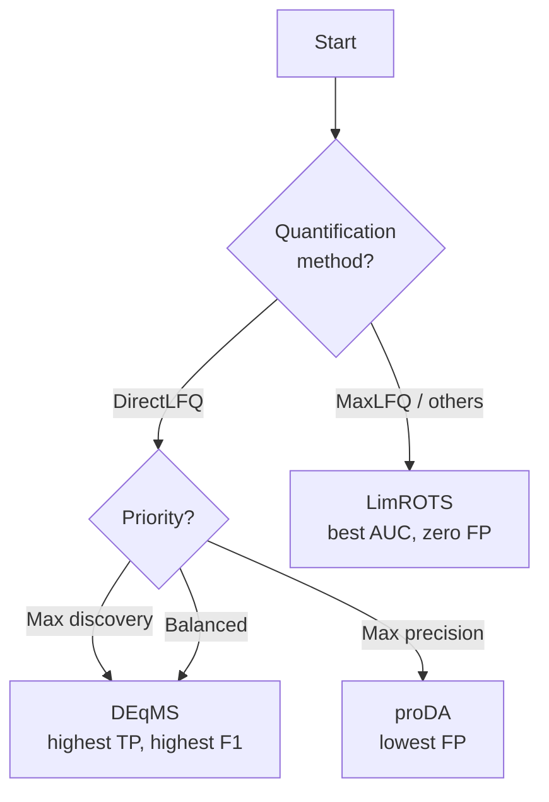

# Differential Expression

Differential expression (DE) analysis identifies proteins whose abundance changes significantly between experimental conditions. mokume provides a catalog of statistical methods implemented in the native Rust kernel, each with distinct strengths.

## Overview

| Method | Model | Key Feature | Needs Peptide Counts |
|--------|-------|-------------|:--------------------:|
| **LimROTS** | Reproducibility-optimized t-statistic | Bootstrap-tuned smoothing | No |
| **DEqMS** | Empirical Bayes with peptide-count weighting | Variance stabilization by spectrum count | Yes |
| **proDA** | Probabilistic dropout model | Dropout-aware likelihood | No |
| **limma** | Moderated t-test (empirical Bayes) | Stable baseline, small-sample friendly | No |
| **ROTS** | Reproducibility-optimized statistic | Data-adaptive test statistic | No |

## Choosing a Method



!!! tip "`--de-method auto`"
    When set to `auto` (the default), mokume selects **DEqMS** for DirectLFQ quantification and **LimROTS** for all other methods. LimROTS needs a complete matrix, so `auto` also selects **DEqMS** when the protein matrix has missing values (for example, without imputation). You can always override this with `--de-method`.

!!! note "No R required"
    All DE methods run in the native Rust kernel. No R, rpy2, or Bioconductor packages are needed. The deterministic kernels (limma / deqms) are cell-exact on real data; the RNG/optimizer-driven methods (rots / limrots / proda) are faithful-not-bit-exact (log2FC cell-exact, p-value rank-level).

## From Python

The pure-Python package exposes the same methods through the
`DifferentialExpression` class. Pass a protein matrix (proteins × samples) and a
sample → condition mapping; it returns one result table per contrast:

```python
from mokume.analysis import DifferentialExpression

# protein_df: a DataFrame with ProteinName + one intensity column per sample
# sample_to_condition: {"sampleA": "Treatment", "sampleB": "Control", ...}
de = DifferentialExpression(method="limrots", fdr_method="bh")
results = de.run_comparisons(
    protein_df,
    sample_to_condition,
    contrasts=[("Treatment", "Control")],
)

# results["Treatment-Control"] -> ProteinName, log2FC, pvalue, adj_pvalue, significance
table = results["Treatment-Control"]
```

`method` accepts any of `limrots`, `deqms`, `proda`, `limma`, or `rots`
(the `ensemble` consensus is exposed through the CLI / `run_ensemble`,
not this class); `fdr_method` is `bh` (default), `ihw`, `bky`, or `storey`.
BKY and Storey fall back to BH when pi0 is not reliable. LimROTS and ROTS report
their own permutation-based FDR, which another FDR request leaves untouched.
`log2fc_threshold="auto"` estimates a mixture-model effect-size gate; the Rust
CLI exposes the same behavior as `--de-log2fc auto`. The
Rust build runs the same methods through the CLI shown below (and the in-process
wheel binding).

## LimROTS

**Reproducibility-Optimized Test Statistic** (Suomi et al., 2017) uses bootstrapped resampling to find the optimal balance between fold-change and variance in a moderated t-statistic.

$$t_{\text{ROTS}} = \frac{\bar{x}_A - \bar{x}_B}{\alpha_1 + \alpha_2 \cdot s}$$

where $\alpha_1$ and $\alpha_2$ are optimized via bootstrap to maximize reproducibility across resampled datasets.

**Strengths:**

- Best overall ranking (highest AUC) on both quantification methods
- Zero or very low false positives — suitable for confirmatory studies
- No external dependencies; fully self-contained

**Weaknesses:**

- Lower sensitivity than DEqMS — may miss real differential proteins
- Computationally more expensive due to bootstrap iterations

```bash
mokume quantify features2proteins -p features.parquet -o proteins.csv -s experiment.sdrf.tsv \
    --de-contrast "A" "B" \
    --de-method limrots \
    --de-fdr-method bh --de-fdr 0.05 --de-log2fc 0.5 \
    --de-output de_results.csv
```

## DEqMS

**DEqMS** (Zhu et al., 2020) extends the limma empirical Bayes framework by weighting variance estimates with peptide/spectrum counts. Proteins quantified from more peptides get tighter variance estimates, boosting statistical power.

$$s^2_{\text{posterior}} = \frac{d_0 s^2_0 + d_i s^2_i}{d_0 + d_i}$$

where $d_0$ and $s^2_0$ are prior degrees of freedom and variance estimated via LOESS regression on peptide counts, and $d_i$, $s^2_i$ are per-protein residual degrees of freedom and variance.

**Strengths:**

- Highest sensitivity and F1 score — finds the most true positives
- Leverages peptide count information for better power
- Particularly effective with DirectLFQ, which preserves peptide-level detail

**Weaknesses:**

- Higher false positive rate than LimROTS or proDA
- Requires peptide count information (automatically provided by the pipeline)
- LOESS variance fitting can be unstable on small datasets, falling back to constant variance

```bash
mokume quantify features2proteins -p features.parquet -o proteins.csv -s experiment.sdrf.tsv \
    --de-contrast "A" "B" \
    --de-method deqms \
    --de-fdr-method bh --de-fdr 0.05 --de-log2fc 0.5 \
    --de-output de_results.csv
```

Peptide counts are supplied automatically by the pipeline.

### Precision weights

`--de-precision-weights` gives DEqMS an observation weight for every protein
value of a MaxLFQ or DirectLFQ matrix. For each protein, the quantification
step compares its ions with the protein profile: each ion's log2 differences
from the profile are centred on their median, which removes the ion's response
factor, and the remaining residual variance is shrunk towards the median of all
proteins with four prior degrees of freedom. A cell's precision is its number of
observed ions divided by that variance, so a value supported by more and more
consistent ions counts more. Imputed cells take the 5th percentile of the
observed precisions, and every weight is bounded by the median observed
variance, so one well-measured sample cannot dominate a group. The weighted
group means and residuals then enter the same count-aware moderation.

The option is off by default. On Mokume's LFQ spike-in benchmark it ranked
true changes slightly better than unweighted DEqMS for both MaxLFQ and
DirectLFQ. `--export-precision` writes the cell precisions; the matrix-level
`mokume.differential_expression` takes them as `precision=`.

```bash
mokume quantify features2proteins -p features.parquet -o proteins.csv -s experiment.sdrf.tsv \
    --quant-method maxlfq \
    --de-contrast "A" "B" \
    --de-method deqms \
    --de-precision-weights \
    --de-output de_results.csv
```

## proDA

**proDA** (Ahlmann-Eltze & Anders, 2020) uses a probabilistic dropout model that treats missing values as informative — proteins below the detection limit are more likely to be missing. This is modeled as a sigmoid dropout curve per sample.

$$P(\text{observed} \mid \mu) = \text{sigmoid}\left(\frac{\mu - \rho}{\zeta}\right)$$

where $\rho$ and $\zeta$ are per-sample dropout midpoint and width parameters estimated from the data.

**Strengths:**

- Lowest false positive rate — highest precision
- Handles missing values probabilistically instead of ignoring or imputing them
- No external dependencies

**Weaknesses:**

- Lowest AUC — weaker overall ranking of proteins
- More conservative, especially on low fold-change contrasts
- Dropout model adds computational overhead and may over-regularize on clean datasets with few missing values

```bash
mokume quantify features2proteins -p features.parquet -o proteins.csv -s experiment.sdrf.tsv \
    --de-contrast "A" "B" \
    --de-method proda \
    --de-fdr-method bh --de-fdr 0.05 --de-log2fc 0.5 \
    --de-output de_results.csv
```

!!! note "When to use proDA"
    proDA is most valuable when your protein matrix has **>30% missing values** and you suspect missingness is abundance-dependent (MNAR). On clean matrices with few missing values, LimROTS or DEqMS will typically outperform.

## limma

**limma** (Ritchie et al., 2015) fits linear models to log-expression data and uses empirical Bayes moderation of standard errors. It is the most widely used method in genomics and a stable baseline for proteomics.

**Strengths:**

- Extremely well-validated across thousands of studies
- Robust with small sample sizes (n ≥ 2 per group)
- Fast and computationally lightweight

**Weaknesses:**

- Does not account for peptide-count information
- May be less powerful than DEqMS when peptide counts are available

```bash
mokume quantify features2proteins -p features.parquet -o proteins.csv -s experiment.sdrf.tsv \
    --de-contrast "A" "B" \
    --de-method limma \
    --de-fdr-method bh --de-fdr 0.05 --de-log2fc 0.5 \
    --de-output de_results.csv
```

### Covariates and paired designs

With `--de-covariate`, limma and DEqMS fit `~0 + condition + covariates` on all
samples with a condition (limma's `lmFit`, `contrasts.fit` and `eBayes`), so a
batch, a numeric covariate such as age, or the subject of a paired design is
estimated jointly with the conditions. Each protein is fitted on its observed
samples; a protein with no residual degrees of freedom takes the prior variance,
as in limma. The fits match limma 3.66.0 and DEqMS 1.28.0 to rounding; with
unequal residual degrees of freedom (missing values) the prior degrees of
freedom can differ from R in the fifth significant digit, because the prior is
fitted with a different one-dimensional optimizer.

With `--de-block`, the levels of an SDRF column (for example the subject, or
the biological replicate of technical replicates) are random blocks instead,
as limma's `duplicateCorrelation` followed by `lmFit(block =, correlation =)`.
REML on each protein's residuals (statmod's `mixedModel2Fit`) gives an
intra-block correlation; the tanh of their 15% trimmed mean on the atanh scale
is the consensus, and every protein is fitted by generalized least squares
with it. The per-protein correlations match limma 3.66.0 and statmod 1.5.2 to
rounding. A protein whose residual variance lies entirely between blocks is
the exception: R gives it either NA or the clamped correlation depending on
rounding, so the consensus can then differ from R.

## ROTS

**ROTS** (Suomi et al., 2017) optimizes a test statistic for maximal reproducibility across bootstrap resamples. Unlike LimROTS (which also incorporates limma empirical Bayes), ROTS uses only the bootstrap-optimized statistic without shrinkage priors.

**Strengths:**

- Data-adaptive: optimizes its own test statistic shape
- Good performance across diverse data types

**Weaknesses:**

- Computationally expensive (bootstrap iterations)
- May be redundant with LimROTS in most scenarios

```bash
mokume quantify features2proteins -p features.parquet -o proteins.csv -s experiment.sdrf.tsv \
    --de-contrast "A" "B" \
    --de-method rots \
    --de-fdr-method bh --de-fdr 0.05 --de-log2fc 0.5 \
    --de-output de_results.csv
```

## Ensemble (top-k consensus)

The `ensemble` method runs several individual DE methods on the same
contrast and combines their per-protein verdicts using a top-k consensus
rule: a protein is called significant only when at least `min_k` member
methods agree on direction (UP or DOWN) and the combined p-value passes the
FDR threshold.

The default members are LimROTS, DEqMS, and proDA. LimROTS needs a complete
matrix, so on a contrast with missing values the default members run limma,
the moderated t-test that LimROTS builds on, in place of LimROTS. A member
list given with `--de-ensemble-method` is used as given, so a `limrots` member
then needs a complete (for example, imputed) matrix.

The member p-values are combined with the Cauchy combination test (Liu & Xie
2020). The members test the same contrast on the same matrix, so their
p-values are strongly dependent. Fisher's method, which assumes independent
p-values, made the combined p-values too small: on the label-free DDA
spike-in studies of mokumebench, the ensemble's median false discovery
proportion was 37%, against 13% for DEqMS. The Cauchy combination stays
valid under dependence for small p-values and gives 11%.

**Output columns** include the median log2FC across members, the
Cauchy-combined p-value (adjusted with the requested FDR method), `n_methods_up`, `n_methods_down`,
and `methods_significant` (comma-separated list of members that called
the protein).

**Strengths:**

- Higher precision than any single method by requiring agreement
- Naturally robust to method-specific failure modes
- Output exposes per-protein method agreement for downstream inspection

**Weaknesses:**

- Cost scales with the number of member methods
- May lose sensitivity for proteins that only one method can detect

```bash
mokume quantify features2proteins -p features.parquet -o proteins.csv -s experiment.sdrf.tsv \
    --de-contrast "A" "B" \
    --de-method ensemble \
    --de-ensemble-method limrots \
    --de-ensemble-method deqms \
    --de-ensemble-method proda \
    --de-ensemble-min-k 2 \
    --de-fdr-method bh --de-fdr 0.05 --de-log2fc 0.5 \
    --de-output de_results.csv
```

## FDR Correction

Mokume supports four requested FDR corrections. LimROTS and ROTS are the
exception: they retain their native permutation-based FDR rather than replacing
it with another requested correction.

| Method | Description | When to Use |
|--------|-------------|-------------|
| `bh` | Benjamini-Hochberg | Default; robust and widely accepted |
| `ihw` | Independent Hypothesis Weighting | When a meaningful covariate exists (e.g., base mean expression) |
| `bky` | Benjamini-Krieger-Yekutieli | Adaptive two-stage control when the estimated null fraction is reliable |
| `storey` | Storey's q-value method | Adaptive control when the estimated null fraction is reliable |

!!! info
    IHW requires a suitable covariate to improve power over BH. If no covariate
    is available, mokume falls back to BH automatically. BKY and Storey also
    fall back to BH when their null-fraction estimate is not reliable.

For an ensemble, eligible non-ROTS members use the requested correction while
ROTS and LimROTS keep their native permutation FDR. Cauchy-combined p-values use
BH by default; BKY or Storey replaces that ensemble-level BH adjustment when
requested and reliable. IHW remains a member-level correction because the
combined rows have no IHW covariate.

## Benchmark Reference

The following results are from the **PXD001819** UPS1 spike-in benchmark (48 UPS1 proteins spiked into yeast lysate, 3 contrasts at FC = 10×, 5×, 2.5×). Values are aggregated across all contrasts. Thresholds: FDR < 0.05, |log2FC| > 1.0.

### MaxLFQ (806 proteins)

| Method | AUC | TP | FP | FN | F1 |
|--------|-----|---:|---:|---:|---:|
| LimROTS+BH | **0.992** | 57 | **0** | 12 | 0.905 |
| DEqMS+BH | 0.985 | **61** | 1 | **8** | **0.933** |
| proDA+BH | 0.972 | 54 | **0** | 15 | 0.878 |

### DirectLFQ (1149 proteins)

| Method | AUC | TP | FP | FN | F1 |
|--------|-----|---:|---:|---:|---:|
| LimROTS+BH | **0.980** | 75 | 4 | 32 | 0.808 |
| DEqMS+BH | 0.969 | **89** | 12 | **18** | **0.860** |
| proDA+BH | 0.956 | 80 | **3** | 27 | 0.843 |

!!! warning "Benchmark limitations"
    These results are from a single spike-in dataset. Performance may vary with different organisms, sample complexity, missing value rates, and experimental designs. Always validate DE results with orthogonal methods.

## Practical Guidance

| Scenario | Recommended | Rationale |
|----------|-------------|-----------|
| **Exploratory / biomarker discovery** | DEqMS | Maximizes true positives; FP can be filtered by downstream validation |
| **Confirmatory / clinical validation** | LimROTS | Minimizes false positives; every reported hit is reliable |
| **High missing-value matrix (>30%)** | proDA | Dropout model handles MNAR missingness |
| **Don't know / general use** | `auto` | DEqMS for DirectLFQ or a matrix with missing values, LimROTS otherwise |
