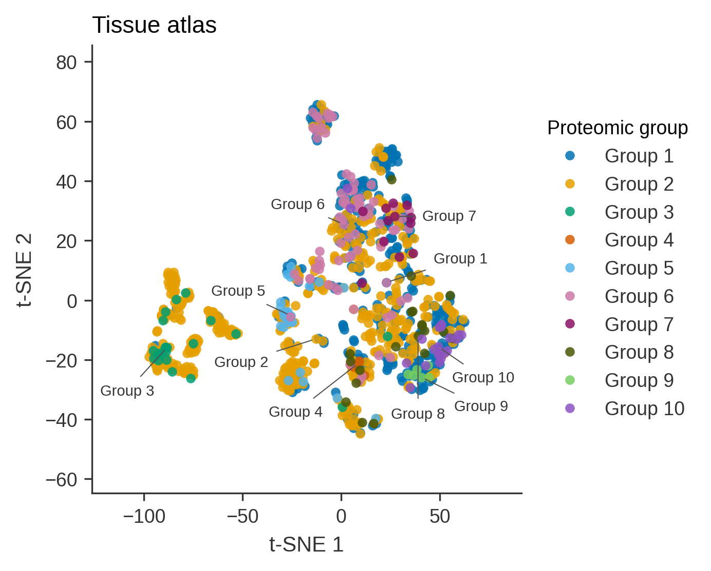
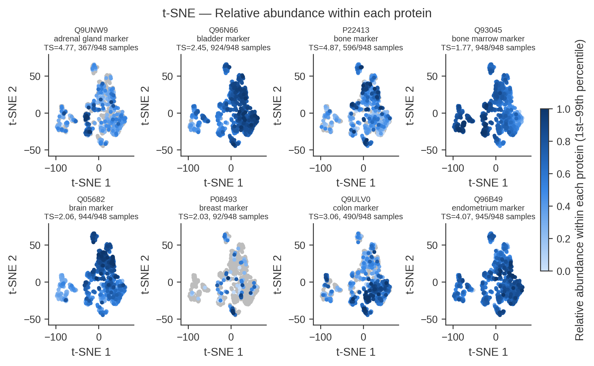
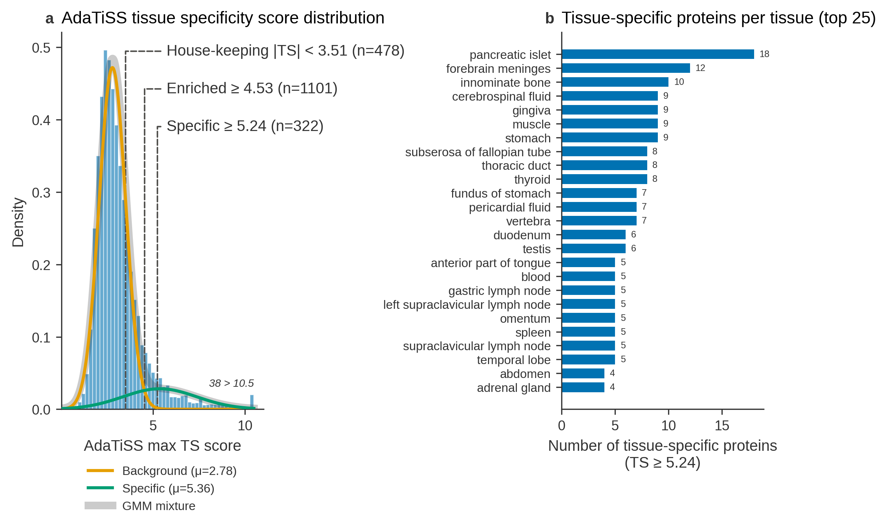

# tissuemap: Tissue Proteome Atlas

`tissuemap` is a Python periphery command in the mokume wheel. It builds a
per-dataset tissue proteome atlas from QPX parquet outputs. It is intended for
atlas-style tissue exploration and tissue-specificity scoring, not for standard
protein quantification from a single experiment.

!!! note "Python periphery command"
    `mokume tissuemap` is exposed by the wheel's unified CLI, but it is not a
    Rust-native compute command. It dispatches to the Python periphery and
    requires the `tissuemap` extra:
    ```bash
    pip install "mokume[tissuemap]"
    ```

## When to Use TissueMap

Use `tissuemap` when you want to:

- build a tissue atlas from one dataset or a directory of datasets
- compute AdaTiSS-based tissue-specificity scores
- generate PCA/t-SNE embeddings and tissue-level marker plots
- save AnnData outputs for downstream exploration

If your goal is standard LFQ or TMT protein quantification, start with
[`features2proteins`](../user-guide/features2proteins.md) instead.

## Expected Input Layout

`--input` can point to either:

- a single dataset directory containing `qpx_output/`
- a parent directory containing multiple dataset directories, each with `qpx_output/`

If a dataset is TMT and auto-detection is not sufficient, specify it explicitly
with repeated `tmt_dataset` values.

## Quick Start

```bash
# Generate a default YAML template
mokume tissuemap --generate-config tissuemap.yaml

# Run a single dataset directory
mokume tissuemap --input QPX_data/tissues-mq/PXD016999 \
    --outdir ./results

# Run a parent directory and identify a TMT dataset explicitly
mokume tissuemap --input QPX_data/tissues-mq \
    --tmt-dataset PXD016999 --outdir ./results --threads 8

# Run with a custom YAML configuration
mokume tissuemap --input QPX_data/tissues-mq \
    --config tissuemap.yaml --outdir ./results
```

The equivalent Python API is `mokume.tissuemap(**kwargs)`. Its wrapper validates
keyword arguments and maps them to the command's exact flags; a `tmt_dataset`
list repeats `--tmt-dataset`.

## What the Pipeline Does

The current TissueMap workflow is organized around per-dataset processing:

1. Discover dataset directories from `scan_dir`
2. Load QPX-derived protein matrices and metadata
3. Apply log2 + median normalization
4. Harmonize tissue labels
5. Filter proteins with excessive missingness or contaminants
6. Apply batch correction
7. Compute AdaTiSS tissue-specificity scores
8. Build PCA + t-SNE embeddings
9. Generate atlas, marker, and tissue-specificity plots
10. Save AnnData and CSV outputs

## Main Options

| Option | Default | Description |
|--------|---------|-------------|
| `-i`, `--input` | required unless `--generate-config` | Dataset directory or parent directory containing datasets |
| `-o`, `--outdir` | `tissuemap_output` | Output directory for all results |
| `--config` | none | YAML configuration file |
| `--generate-config` | none | Write a default YAML template and exit |
| `--tmt-dataset` | auto | Mark one or more dataset IDs as TMT; repeat for multiple datasets |
| `-t`, `--threads` | `8` | Threads for dataset processing and embedding |
| `--dpi` | `250` | Plot resolution override |
| `--impute-method` | config default | Imputation method used before embedding |
| `--embedding-method` | config default | `tsne` or `umap` |

## Configuration Workflow

Use `generate_config` when you want to tune the pipeline before running it
repeatedly:

```python
import mokume

mokume.tissuemap(generate_config="tissuemap.yaml")
```

The generated YAML exposes the main configuration groups:

- `input` — dataset discovery, TMT overrides, minimum tissue sample settings
- `filtering` — NaN threshold and contaminant filtering
- `tissue_specificity` — AdaTiSS thresholds and scoring controls
- `embedding` — PCA/t-SNE parameters
- `plotting` — DPI, PDF export, marker plot controls
- `output` — output directory

CLI values such as `--input`, `--outdir`, `--threads`, and `--dpi`
override the YAML file.

## Output Files

Each processed dataset gets its own output directory.

| File | Description |
|------|-------------|
| `<ds_id>.corrected.h5ad` | Batch-corrected sample-level AnnData with embeddings and metadata |
| `<ds_id>.ts_scores.h5ad` | Tissue-specificity score matrix as AnnData |
| `protein_ts_scores.csv` | Per-protein tissue-specificity scores and enrichment categories |
| `plots/` | All figures (PNG, plus a PDF copy of each when `save_pdf` is enabled) — see below |

Every figure in `plots/` is written as a PNG and, when `plotting.save_pdf` is
enabled (the default), an accompanying PDF:

| Plot file | Shows |
|-----------|-------|
| `tissue_atlas.png` | t-SNE tissue atlas: samples coloured by proteomic cluster with matching group markers |
| `tissue_dendrogram.png` | Ward/correlation tissue dendrogram with neutral leaf labels and group markers |
| `slide_atlas_dendrogram.png` | Combined atlas + dendrogram with the same group colours and shapes |
| `marker_tsne.png` | t-SNE marker panels sharing a 0–1 within-protein relative-abundance scale |
| `marker_heatmap.png` | Row z-scores of top tissue markers across tissues (`RdBu_r`, centred at zero) |
| `marker_dotplot.png` | Dot plot of mean relative abundance and fraction of samples detected per tissue |
| `ts_distribution.png` | AdaTiSS TS-score distribution + tissue-specific protein counts |
| `specific_per_tissue.png` | Bar chart of tissue-specific protein counts per tissue |
| `pca_scree.png` | PCA scree plot (variance explained per component) |

The atlas uses the shared six-colour palette for proteomic groups, with circles
for up to six groups and distinct colour/shape pairs for larger group counts.
The dendrogram leaf markers use the same codes; all text stays neutral. A group
is named for an organ family only when that family includes more than half its
tissues. Mixed groups and repeated names use `Group N`.

Marker t-SNE colours are clipped and scaled between each protein's detected
1st and 99th percentiles. The shared colourbar shows relative abundance within
each protein, not comparable absolute abundance between proteins. Missing
samples stay grey. Marker heatmaps display `ENTRY` for UniProt identifiers of
the form `db|ACC|ENTRY_SPECIES`; the underlying identifiers are unchanged.
Scree and specificity charts use the shared single-series colour. Thresholds
use neutral dashed lines with direct labels; GMM components use the condition
palette with a legend. `specific_per_tissue.png` is also available through
`plot_specific_per_tissue`; the CLI includes these counts in `ts_distribution.png`.

## Example Outputs

Figures below are real `tissuemap` output on **PXD030304** (a 949-cell-line
proteomic panel). These example images predate the shared plotting style above.

{ width="100%" }

*`tissue_atlas.png` — the cell-line proteomes embedded by t-SNE and coloured by
organ of origin in the earlier rendering. Current plots use proteomic groups.*

{ width="100%" }

*`marker_tsne.png` — the same embedding, each panel coloured by a top
tissue-marker's expression in the earlier rendering. Current panels share the
within-protein relative-abundance scale.*

{ width="100%" }

*`ts_distribution.png` — AdaTiSS tissue-specificity score distribution (with the
GMM-fitted thresholds) and the tissue-specific protein count per tissue.*

## Practical Tips

- Use `quantify features2proteins` for standard quantification workflows; use `tissuemap`
  for atlas-style tissue analysis.
- Start with the generated YAML template if you expect to rerun multiple datasets.
- Pass a list to `tmt_dataset` when one or more datasets should be treated as TMT
  explicitly.
- Keep the default plotting enabled for the first run so you can inspect atlas
  quality and marker behavior.
